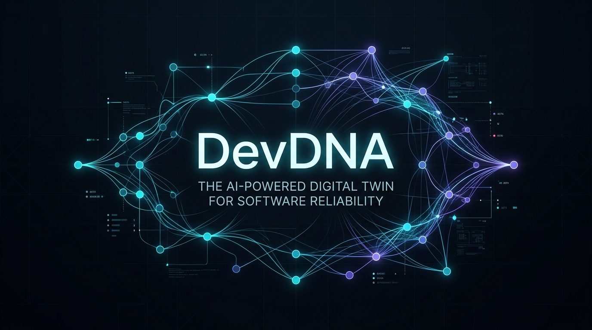
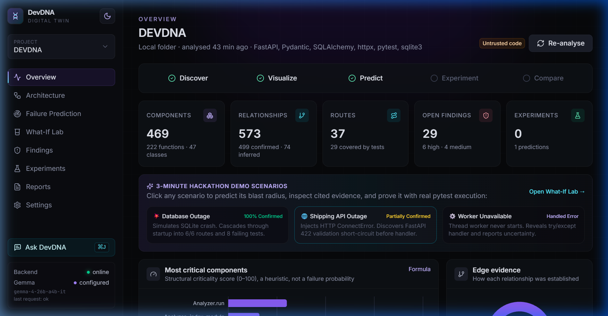
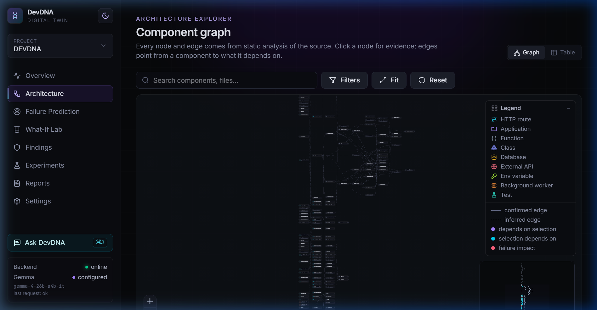
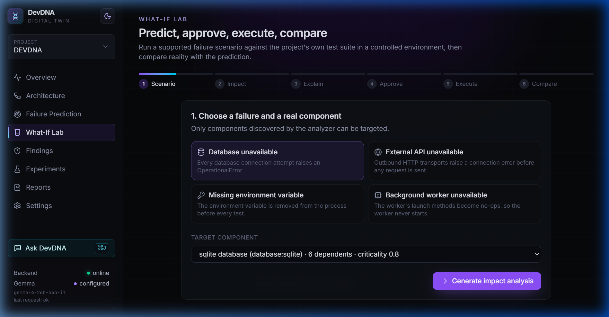
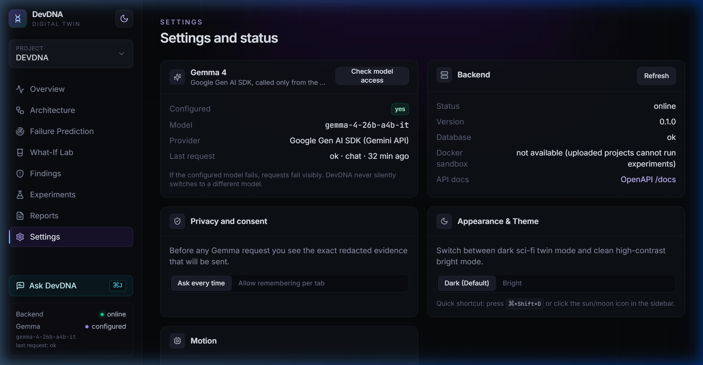
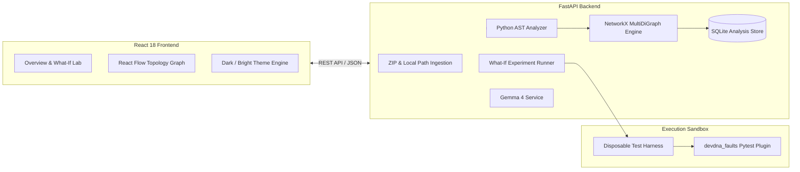

# DevDNA: The AI-Powered Digital Twin for Software Reliability

<div align="center">

[](https://github.com/SUBHA22-CODER/DEVDNA-/actions)
[](https://python.org)
[](https://fastapi.tiangolo.com)
[](https://react.dev)
[](https://tailwindcss.com)
[](https://ai.google.dev/gemma)

**Predict failure blast radius in Python codebases, and prove or disprove the prediction by injecting faults into real pytest test suites.**

[Explore Architecture](docs/ARCHITECTURE.md) • [Algorithm Reference](docs/ALGORITHM.md) • [Security & Isolation](docs/SECURITY.md) • [Contributing](CONTRIBUTING.md)

</div>

---

<div align="center">
  
</div>

---

## 1. The Problem: The Hidden Blast Radius of Modern Codebases

In growing Python systems, answering a deceptively simple question is notoriously difficult:
> *"If our SQLite database, external payment gateway, or background worker fails, which specific HTTP routes crash, which user workflows fail, and will our test suite catch it?"*

* **Architecture diagrams become stale** days after they are drawn.
* **Traditional CI suites test the happy path**—they cannot model cascading failure propagation or single points of failure (SPOFs).
* **AI assistants guess from intuition**, hallucinating components and failure paths without mathematical backing.

---

## 2. The Solution: A Deterministic Software Digital Twin

DevDNA constructs an evidence-backed **digital twin** of any Python repository. It computes deterministic failure blast radius through reverse graph search, reasons about failure mechanisms using Google Gemma 4, and then **empirically validates the prediction** inside an isolated pytest fault-injection sandbox.

```
DISCOVER  ───────►  VISUALIZE  ───────►  PREDICT  ───────►  EXPERIMENT  ───────►  COMPARE
Static AST          Interactive          Dual Reverse       Controlled           Empirical
Analysis            Topology Graph       BFS + Gemma 4      pytest Sandbox       Confusion Matrix
(Zero Execution)    (React Flow)         (Definite/Poss)    (Fault Injection)    (TP, FP, TN, FN)
```

---

## 3. Visual Tour & Interface

<div align="center">

### Repository Health & Failure Readiness Dashboard

*Discovers components, analyzes confirmed vs. inferred evidence, flags structural risks, and launches 3-minute hackathon scenarios.*

---

### Interactive Dependency Topology Graph

*Interactive node-and-edge exploration powered by `@xyflow/react` and Dagre layout, with live blast-radius highlighting and AST call-site inspection.*

---

### What-If Lab: Prediction vs. Observed Reality

*Side-by-side verification: baseline test outcomes vs. fault-injected outcomes with automated confusion matrix accuracy scoring.*

---

### Dual Dark & Bright Theming

*Switch instantly between DevDNA's signature dark digital-twin mode and high-contrast bright mode with `⌘+Shift+D`.*

</div>

---

## 4. Key Engineering Capabilities

1. **Static AST Analysis (Zero Code Execution During Ingestion):**
   * Uses Python's native `ast` module to scan functions, routes, database sessions, environment variable reads, and outbound HTTP clients.
   * Every discovered edge carries source file, line number, a redacted code snippet, and evidence classification (`confirmed` vs `inferred`).
2. **Deterministic Dual Reverse BFS Propagation:**
   * Traverses callers backward from a failure point.
   * Understands `try-except` blocks: an edge protected by an exception handler that catches the failure without re-raising is marked as **Possible** (uncertain) instead of **Definite**.
3. **Component Criticality Score ($0 - 100$):**
   * Combines blast radius, normalized betweenness centrality, and user-facing HTTP route share into a single structural risk metric.
4. **Empirical What-If Lab (Controlled Fault Injection):**
   * Runs the project's own `pytest` suite twice: baseline healthy run, then faulted run using the `devdna_faults` pytest plugin.
   * Evaluates predictions against observed JUnit XML results to compute True Positives, False Positives, True Negatives, and False Negatives.
5. **Grounded Gemma 4 AI Analysis (`gemma-4-26b-a4b-it`):**
   * Accesses Gemma 4 server-side via the official Google Gen AI SDK.
   * All explanations are strictly constrained to cited evidence tokens ($E_1 \dots E_n$). Gemma explains *why* a failure occurs; it never decides *which* components are affected.
   * Features client-side consent review, Pydantic schema validation, and automatic exponential backoff retry.

---

## 5. Mathematical Foundations & Risk Formula

*Full technical details and proofs are documented in [docs/ALGORITHM.md](docs/ALGORITHM.md).*

DevDNA calculates a structural vulnerability score for every non-test component:

$$\mathbf{Criticality} = 100 \times \Big(0.50 \cdot \text{BlastRadius} \;+\; 0.30 \cdot \text{BetweennessNorm} \;+\; 0.20 \cdot \text{RouteShare}\Big)$$

### Metric Definitions
* **Blast Radius (50%):** $\frac{|\text{Dependents}(v)|}{\max(1, |\text{Non-Test Components}| - 1)}$ (fraction of codebase affected if $v$ fails).
* **Betweenness Norm (30%):** $\frac{B(v)}{\max_u B(u)}$ (Brandes' betweenness centrality on the dependency DAG).
* **Route Share (20%):** $\frac{|\text{Routes Depending on } v|}{|\text{Total Discovered Routes}|}$ (impact on user-facing HTTP endpoints).

### Worked Example
For a component with $16$ of $20$ non-test dependents ($\text{Blast} = 0.80$), normalized betweenness of $0.80$, and impacting $6$ of $6$ routes ($\text{RouteShare} = 1.00$):
$$\mathbf{Score} = 100 \times (0.5 \times 0.80 + 0.3 \times 0.80 + 0.2 \times 1.00) = \mathbf{84.0} \quad \text{(High Risk)}$$

---

## 6. System Architecture



*For complete architectural boundaries and security models, see [docs/ARCHITECTURE.md](docs/ARCHITECTURE.md) and [docs/SECURITY.md](docs/SECURITY.md).*

---

## 7. Technology Stack

| Layer | Technologies | Responsibilities |
| :--- | :--- | :--- |
| **Backend API** | Python 3.11+, FastAPI, Uvicorn, Pydantic v2, SQLAlchemy, SQLite | High-performance async REST service, analysis persistence, schema validation |
| **Static Analysis** | Python native `ast`, NetworkX | AST visitor traversal, call-site resolution, directed dependency multi-graph |
| **Testing & Faults** | `pytest`, custom `devdna_faults` plugin, JUnit XML parser | Baseline vs. faulted test execution, socket/db/env interception |
| **Open Source AI** | Google Gemma 4 26B (`gemma-4-26b-a4b-it`), Google Gen AI SDK | Evidence-grounded architectural summaries and failure mitigation recommendations |
| **Frontend Web** | React 18, Vite, Tailwind CSS 4, Framer Motion, `@xyflow/react` | Interactive graph visualization, reactive what-if lab, dual theming |
| **Security & Sandbox** | Multi-pattern regex redaction, path traversal guards, Docker | Strict execution isolation, API key sanitization, environment scrubbing |

---

## 8. Quickstart & Local Setup

### Prerequisites
* **Python:** 3.11 or later
* **Node.js:** 18 or later (npm 9+)
* **Google Gemini API Key (Optional):** Required only for Gemma AI explanations. All static analysis, graphs, predictions, and pytest experiments function 100% without an API key.

### 1. Backend Setup
```bash
cd backend
python -m venv .venv

# Activate virtual environment
# Windows (PowerShell):
.\.venv\Scripts\activate
# macOS/Linux:
source .venv/bin/activate

# Install dependencies
pip install -r requirements.txt

# Configure environment
copy .env.example .env    # Windows
# cp .env.example .env    # macOS/Linux
```

*(Optional)* Edit `backend/.env` to configure your `GEMINI_API_KEY`:
```ini
GEMINI_API_KEY=AIzaSy...
GEMMA_MODEL=gemma-4-26b-a4b-it
DEVDNA_ALLOWED_LOCAL_ROOTS=C:\Users\Subha Prasana Parida
```

Launch the backend API:
```bash
uvicorn app.main:app --reload --port 8000
```
*API interactive documentation is available at `http://127.0.0.1:8000/docs`.*

### 2. Frontend Setup
```bash
cd frontend
npm install
npm run dev
```

Open **`http://localhost:5173`** in your browser.

---

## 9. Automated Test Suites

DevDNA maintains a comprehensive automated test suite across backend algorithms, security boundaries, and UI components:

```bash
# Run backend pytest suite (69 tests)
cd backend && python -m pytest -v

# Run frontend Vitest suite (12 tests)
cd frontend && npm test -- --run

# Compile frontend production bundle
cd frontend && npm run build
```

*Backend tests isolate the environment and mock external GenAI calls to ensure tests never require live credentials.*

---

## 10. 3-Minute Hackathon Demo Script

| Time | View / Action | What to Point Out to Judges |
| :--- | :--- | :--- |
| **0:00** | Click **Explore Demo Project** | Real AST stages stream in (scanning files, parsing syntax trees, indexing calls, resolving routes). |
| **0:25** | **Overview Dashboard** | Discovered 76 components and 109 relationships. Shows confirmed vs. inferred edges, and criticality distribution. |
| **0:50** | **Architecture View** | Search for `get_connection`. Drawer reveals exact file/line, real source code excerpt, and incoming vs. outgoing dependencies. Press **Blast Radius** to illuminate the failure tree. |
| **1:20** | **What-If Lab** $\rightarrow$ Database Unavailable | Select `sqlite` database. Dual Reverse BFS predicts 21 affected components, 6/6 routes down, 8 tests failing, 4 tests passing. |
| **1:50** | **Explain with Gemma** | Consent modal previews exact redacted evidence tokens ($E_1 \dots E_{17}$). Gemma 4 explains failure mechanism while citing evidence tokens. |
| **2:20** | **Validate in What-If Lab** | Run the experiment. Real pytest executes in ~6 seconds in the sandbox. **Verdict: Prediction Confirmed** (12/12 matches, fault triggered 8 times). |
| **2:45** | **External API Unavailable** | Run scenario against payment provider. **Verdict: Partially Confirmed**. Explains why `test_order_validation` passed (FastAPI schema validation caught invalid payload before the handler ran). |

---

## 11. Global Keyboard Shortcuts

| Shortcut | Action |
| :--- | :--- |
| <kbd>⌘</kbd> / <kbd>Ctrl</kbd> + <kbd>K</kbd> or <kbd>/</kbd> | Open New Project Modal (Local folder or ZIP upload) |
| <kbd>⌘</kbd> / <kbd>Ctrl</kbd> + <kbd>J</kbd> | Toggle **Ask DevDNA** AI Assistant Drawer |
| <kbd>⌘</kbd> / <kbd>Ctrl</kbd> + <kbd>Shift</kbd> + <kbd>D</kbd> | Toggle **Dark / Bright Mode** Theme |
| <kbd>Esc</kbd> | Close any active modal or drawer |

---

## 12. Security & Privacy Design

* **Zero Arbitrary Execution:** DevDNA accepts no user-supplied shell commands; all tests execute through a fixed `python -m pytest` command.
* **Scrubbed Environment:** The test harness strips all host environment variables, tokens, and server secrets.
* **Secret Redaction:** Code snippets and stack traces pass through an automated regex redaction engine (`redact.py`) before leaving the backend.
* **Docker Hardening:** Untrusted uploaded code requires Docker (`--network none`, `--read-only`, `--cap-drop ALL`, `no-new-privileges`).

---

## 13. Repository Structure

```
DEVDNA/
├── assets/                     # Genuine screenshots and hero branding
├── docs/                       # Technical specifications & architecture
│   ├── ARCHITECTURE.md         # Subsystems, sequence diagrams, and data flow
│   ├── ALGORITHM.md            # Criticality formula, Dual BFS, confusion matrix
│   └── SECURITY.md             # Threat model, sandboxing, and secret redaction
├── backend/                    # FastAPI Backend Service
│   ├── app/
│   │   ├── ai/                 # Gemma 4 integration (gemma-4-26b-a4b-it, retry loop)
│   │   ├── analyzer/           # Python AST parser, route resolver, redaction
│   │   ├── api/                # REST endpoints (projects, predictions, experiments)
│   │   ├── experiments/        # What-If runner and devdna_faults pytest plugin
│   │   ├── graph/              # NetworkX MultiDiGraph engine and Dual BFS
│   │   ├── models/             # SQLAlchemy database models
│   │   └── services/           # Findings rules, reports, graph serialization
│   ├── tests/                  # 69 automated pytest unit and integration tests
│   ├── sample_project/         # ShopLite reference e-commerce repository
│   └── requirements.txt        # Backend dependencies
├── frontend/                   # React 18 + Vite Web Application
│   ├── src/
│   │   ├── components/         # AIPanel, NewProjectModal, ImpactView, PredictionVsReality
│   │   ├── layouts/            # AppLayout with theme toggle and global shortcuts
│   │   ├── pages/              # Overview, Architecture, What-If Lab, Findings, Reports
│   │   └── index.css           # Tailwind CSS 4 theme tokens & Bright mode overrides
│   └── package.json            # Frontend dependencies
├── .github/                    # CI workflows and issue templates
└── CONTRIBUTING.md             # Contributor setup and coding guidelines
```

---

## 14. License

DevDNA is developed by [SUBHA22-CODER](https://github.com/SUBHA22-CODER). All source code and documentation are provided for evaluation and open-source hackathon review.
