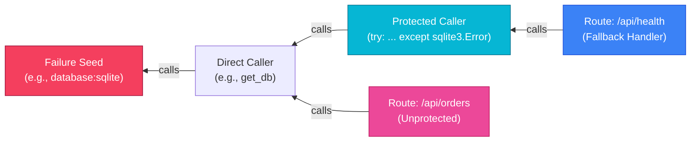

# DevDNA Algorithms & Mathematical Foundations

DevDNA uses deterministic graph algorithms and topological heuristics to predict how component failures ripple through Python codebases. This document details the exact mathematical formulas, graph traversals, and evaluation metrics used across the system.

---

## 1. Component Criticality Score (0 – 100)

*Implementation Reference:* [`backend/app/graph/engine.py:71-98`](../backend/app/graph/engine.py#L71-L98)

DevDNA calculates a structural vulnerability score for every non-test component (databases, functions, routes, external APIs) using a multi-factor topological heuristic:

$$\mathbf{Criticality} = 100 \times \Big(0.50 \cdot \text{BlastRadius} \;+\; 0.30 \cdot \text{BetweennessNorm} \;+\; 0.20 \cdot \text{RouteShare}\Big)$$

### Factor Breakdown

| Factor | Weight | Formula | Description |
| :--- | :--- | :--- | :--- |
| **Blast Radius** | **50%** | $\frac{|\text{Dependents}(v)|}{\max(1, |\text{Non-Test Nodes}| - 1)}$ | The fraction of all non-test components in the codebase that transitively reach $v$ along propagating dependency edges. |
| **Betweenness Norm** | **30%** | $\frac{B(v)}{\max_{u} B(u)}$ | Normalized betweenness centrality (Brandes' algorithm) on the propagating subgraph. Measures how often component $v$ sits on shortest dependency paths between other pairs of components. |
| **Route Share** | **20%** | $\frac{|\text{Routes}(v)|}{|\text{Total Routes}|}$ | The fraction of discovered HTTP route endpoints that depend directly or indirectly on component $v$. |

> **Crucial Engineering Distinction:** The Criticality Score is explicitly calibrated as a **structural topology heuristic**, *not* a probabilistic failure rate. It identifies architectural single-points-of-failure (SPOFs).

---

### Step-by-Step Hypothetical Calculation Example

Consider a hypothetical microservice repository with:
* Total non-test components: $N = 21$ (so $N - 1 = 20$)
* Total HTTP route endpoints: $R_{\text{total}} = 6$
* Maximum betweenness centrality observed in the entire graph: $\max(B) = 0.40$

We evaluate a core database helper component `db.get_connection`:
1. **Dependents count:** $16$ components transitively call `db.get_connection`.
   $$\text{BlastRadius} = \frac{16}{20} = 0.80$$
2. **Betweenness centrality:** Brandes' algorithm computes $B(\text{db.get\_connection}) = 0.32$.
   $$\text{BetweennessNorm} = \frac{0.32}{0.40} = 0.80$$
3. **Route dependency:** All $6$ HTTP endpoints reach this database connection.
   $$\text{RouteShare} = \frac{6}{6} = 1.00$$

**Final Criticality Score:**
$$\mathbf{Score} = 100 \times \Big(0.50 \times 0.80 \;+\; 0.30 \times 0.80 \;+\; 0.20 \times 1.00\Big)$$
$$\mathbf{Score} = 100 \times \Big(0.40 + 0.24 + 0.20\Big) = 100 \times 0.84 = \mathbf{84.0} \quad \text{(High Risk)}$$

---

## 2. Dual Reverse BFS Impact Propagation

*Implementation Reference:* [`backend/app/graph/engine.py:144-186`](../backend/app/graph/engine.py#L144-L186)

When simulating a failure scenario (e.g. `SQLite database down` or `missing ENV var`), DevDNA starts at the seed component and performs **two simultaneous reverse graph traversals**:

### Traversal Algorithms

1. **Unconstrained Reachability ($P_{\text{possible}}$)**:
   Traverses all incoming edges of type `calls`, `handled_by`, `served_by`, `runs_on_startup`, `uses_database`, `calls_http`, `reads_env`.
2. **Guarded Reachability ($P_{\text{definite}}$)**:
   Traverses the same edges, but evaluates AST-discovered call-site exception handlers (`_edge_guard`). If an edge is enclosed in a `try-except` block catching a relevant exception (and does *not* re-raise), traversal halts along that edge.

### Component Certainty Classification

$$\text{Certainty}(v) = \begin{cases} 
\mathbf{Definite} & \text{if } v \in P_{\text{definite}} \\
\mathbf{Possible} & \text{if } v \in P_{\text{possible}} \setminus P_{\text{definite}} \quad (\text{Error handled on call path}) \\
\mathbf{Unaffected} & \text{if } v \notin P_{\text{possible}}
\end{cases}$$

Every *Possible* component explicitly cites the source file, line number, and handled exception types responsible for shielding the upstream caller.

---

## 3. What-If Lab Empirical Evaluation Formulas

*Implementation Reference:* [`backend/app/experiments/runner.py:226-256`](../backend/app/experiments/runner.py#L226-L256)

When tests run inside the fault-injection sandbox, DevDNA matches predicted test outcomes with observed JUnit outcomes:

### Outcome Definitions
* **True Positive (TP):** Predicted `fail` and test observed `failed` or `error`.
* **True Negative (TN):** Predicted `pass` and test observed `passed`.
* **False Positive (FP):** Predicted `fail` and test observed `passed` (e.g. mock or cached).
* **False Negative (FN):** Predicted `pass` and test observed `failed`.
* **Definite Predictions:** $D = \text{TP} + \text{FP} + \text{TN} + \text{FN}$.

### Accuracy & Validation Metrics

$$\text{Accuracy} = \frac{\text{TP} + \text{TN}}{\text{TP} + \text{FP} + \text{TN} + \text{FN}}$$

$$\text{Precision} = \frac{\text{TP}}{\text{TP} + \text{FP}}, \qquad \text{Recall} = \frac{\text{TP}}{\text{TP} + \text{FN}}$$

### Honest Evaluation Rules
1. **Baseline Exclusion:** Tests that fail or are skipped in the baseline (healthy) run are excluded from the metric denominator.
2. **Uncertainty Separation:** Tests marked `may_fail` (where an exception handler exists on the path) are **never counted in the definite denominator**, preventing artificial accuracy inflation.
3. **Verdict Categories:**
   * **Confirmed:** $100\%$ of definite predictions match observed outcomes ($\text{FP} = 0, \text{FN} = 0$).
   * **Partially Confirmed:** Some definite predictions matched, but at least one mismatched.
   * **Contradicted:** Zero definite predictions matched.
   * **Inconclusive:** Injected fault was never triggered, or baseline failed.

---

## 4. Neuro-Symbolic Hybrid Failure Model

DevDNA deliberately rejects the naive approach of relying solely on an LLM to predict software failure blast radius from raw source text. In real-world enterprise codebases exceeding tens of thousands of lines, pure LLMs suffer from three fatal flaws:
1. **Context Window Exhaustion:** Inability to ingest complete multi-module call trees simultaneously.
2. **Hallucinated Invocations:** Inventing non-existent functions, missing dynamic reflection, or hallucinating imports.
3. **Non-Deterministic Reachability:** Giving different blast radius numbers on identical code across runs.

### The Two-Tier Architecture

$$\mathbf{FailureModel}(v, \text{Fault}) = \Big\langle \underbrace{\mathcal{G}_{\text{AST}}(v)}_{\text{Symbolic Bounds}}, \; \underbrace{\Phi_{\text{Gemma 4}}(\mathcal{G}(v), \text{Code}, \text{Fault})}_{\text{Neural Semantic Reasoning}} \Big\rangle$$

1. **Symbolic Layer (AST Reachability DAG):**
   * Computes the deterministic, mathematically proven reachability envelope ($P_{\text{definite}}$ and $P_{\text{possible}}$).
   * Guarantees zero hallucinated components and zero missed static edges.
2. **Neural Layer (Google Gemma 4):**
   * **Semantic Survivability:** Evaluates whether generic `except Exception:` blocks genuinely handle the failure gracefully or leave corrupted internal application state.
   * **Dynamic Scenario Synthesis:** Translates natural language requests into concrete runtime fault injection specifications with custom exception hierarchies.
   * **Multimodal Visual Inspection:** Ingests visual architecture diagrams and verifies topological drift against AST graph nodes.
   * **Post-Experiment Reconciliation:** Pinpoints the root causes of test mismatches (e.g., hidden test mocks, unasserted database side effects, or cached responses).

