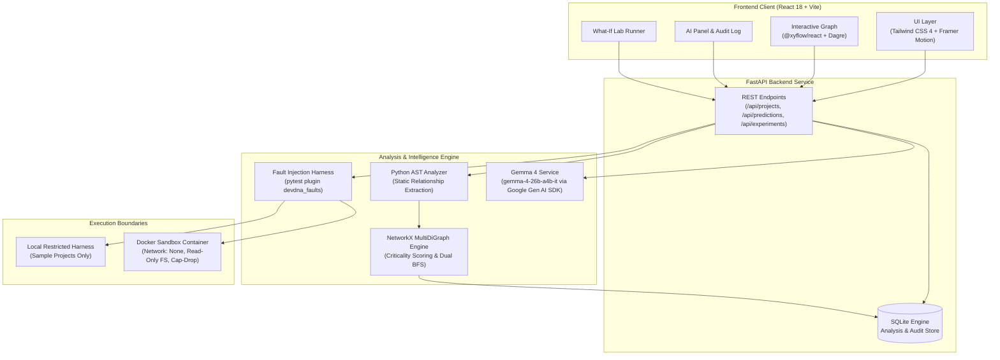
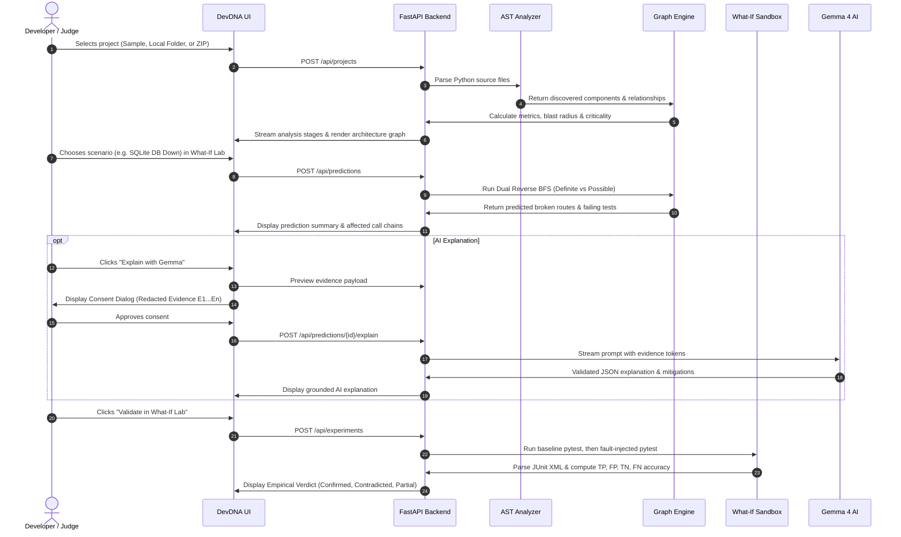

# DevDNA System Architecture

DevDNA is an AI-powered software reliability engine and digital twin designed to analyze Python repositories, map dependency topology, predict systemic failure blast radius, and validate predictions empirically through sandboxed fault injection.

---

## 1. High-Level Architecture Overview

---

## 2. Core Subsystems & Responsibilities

### A. Python AST Static Analyzer (`backend/app/analyzer/`)
* **Role**: Ingests Python source trees without executing the target application code.
* **Mechanism**: Uses Python's native `ast` module to traverse the Abstract Syntax Tree.
* **Extraction Targets**:
  * **Functions & Methods**: Call sites, arguments, return signatures, exceptions raised (`Raise` nodes).
  * **HTTP Endpoints (Routes)**: Decorators from FastAPI (`@app.get`, `@router.post`), Flask (`@app.route`).
  * **Databases & ORMs**: SQLite, PostgreSQL, SQLAlchemy sessions, connection pools.
  * **Environment Variables**: `os.environ[...]`, `os.getenv(...)`, `.get(...)` calls.
  * **Outbound HTTP Calls**: `httpx`, `requests`, `urllib` client invocations, timeouts, retry configurations.
  * **Exception Handling**: `Try` blocks, handled exception types, and whether exceptions are re-raised.

### B. Neuro-Symbolic Dependency Graph Engine (`backend/app/graph/engine.py`)
* **Role**: Builds an in-memory directed multi-graph (`networkx.MultiDiGraph`) modeling dependency propagation and acts as the symbolic co-processor to Gemma 4.
* **Graph Conventions**:
  * **Edge Direction**: `Source depends on Target` (e.g. `A --calls--> B` implies that if $B$ fails, $A$ may be affected).
  * **Propagating Edges**: `calls`, `handled_by`, `served_by`, `runs_on_startup`, `uses_database`, `calls_http`, `reads_env`, `exercises`.
* **Algorithms**:
  * **Component Criticality**: Multi-factor topological score ($0 - 100$) combining blast radius, betweenness centrality, and user-facing HTTP route share.
  * **Dual Reverse BFS**: Traverses callers upward from a failure seed to compute **Definite** vs. **Possible** reachability bounds.
  * **Arbitrary Dynamic Scenarios**: Supports user-defined or Gemma 4-synthesized failure scenarios with custom exception hierarchies and dynamic fault injection specifications.

### C. What-If Lab & Fault Injection Runner (`backend/app/experiments/`)
* **Role**: Executes the codebase's existing test suite twice (baseline vs. faulted) to verify predictions.
* **Fault Injection Plugin (`devdna_faults.py`)**: Intercepts targeted subsystems (database connection drops, external HTTP timeouts, missing environment variables, or dynamic function/exception patches) at runtime.
* **Comparison Engine**: Parses JUnit XML xunit2 reports, filters baseline-failing tests, and computes Confusion Matrix metrics ($\text{Accuracy}, \text{Precision}, \text{Recall}$) enriched with AI empirical reconciliation.

### D. Gemma 4 Cognitive Engine: Vision & Language (`backend/app/ai/gemma.py`)
* **Role**: Foundational neural co-processor for multimodal visual architecture audits, dynamic failure scenario synthesis, cascading risk evaluation, and empirical reconciliation.
* **Model**: Google Gemma 4 26B (`gemma-4-26b-a4b-it`) accessed server-side via the official Google Gen AI SDK.
* **Multimodal Visual Ingestion**:
  * Uses Google Gen AI SDK `types.Part.from_bytes` to visually parse uploaded C4 architecture diagrams, cloud topologies, whiteboard sketches, or error screenshots.
  * Audits visual components against the AST digital twin to detect architectural drift and unmitigated single points of failure.
* **Grounding & Transparency**:
  * Prompts contain tagged evidence tokens ($E_1 \dots E_n$) linking directly to AST nodes.
  * Strict Pydantic schema validation (`MultimodalAuditResult`, `DynamicScenarioSpec`, `NeuroSymbolicFailurePrediction`, `ArchitectureExplanation`, `FailureAnalysis`).
  * Automatic exponential backoff retry on transient provider errors.

### E. Frontend Application (`frontend/src/`)
* **Role**: High-performance, accessible, interactive web interface.
* **Technology**: React 18, Vite, Tailwind CSS 4, Framer Motion, `@xyflow/react` with Dagre graph layout, Recharts.
* **Features**:
  * Real-time interactive dependency graph exploration with node-level blast radius highlighting.
  * Instant Dark and Bright mode theming.
  * Global keyboard navigation (`⌘K` New Project, `⌘J` Ask DevDNA, `⌘+Shift+D` Theme Toggle).
  * 3-minute hackathon demo scenario launchpad.

---

## 3. Data Flow: From Code to Twin

---

## 4. Security & Isolation Boundaries

1. **Local Restricted Harness**:
   * Restricted strictly to the bundled, trusted sample project.
   * Runs in an isolated temporary directory with scrubbed environment variables (no host API keys or server secrets).
   * Fixed test execution command (`python -m pytest`); arbitrary user commands are never accepted.
2. **Docker Container Sandbox**:
   * Required for any uploaded or external codebase.
   * Container parameters: `--network none`, `--read-only`, `--cap-drop ALL`, `--security-opt no-new-privileges`, CPU/PID/memory caps.
3. **Secret Redaction**:
   * All file snippets, exception strings, and evidence tokens pass through `backend/app/analyzer/redact.py` before leaving the server or being stored in SQLite.
